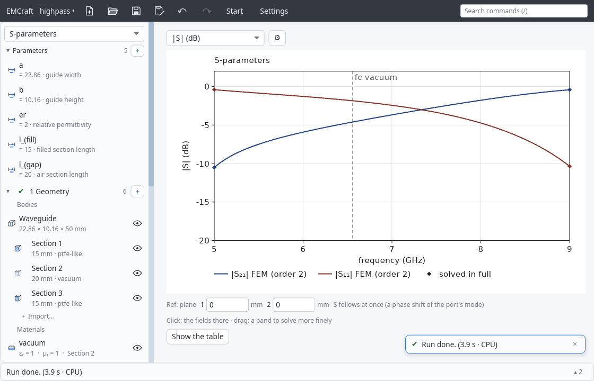
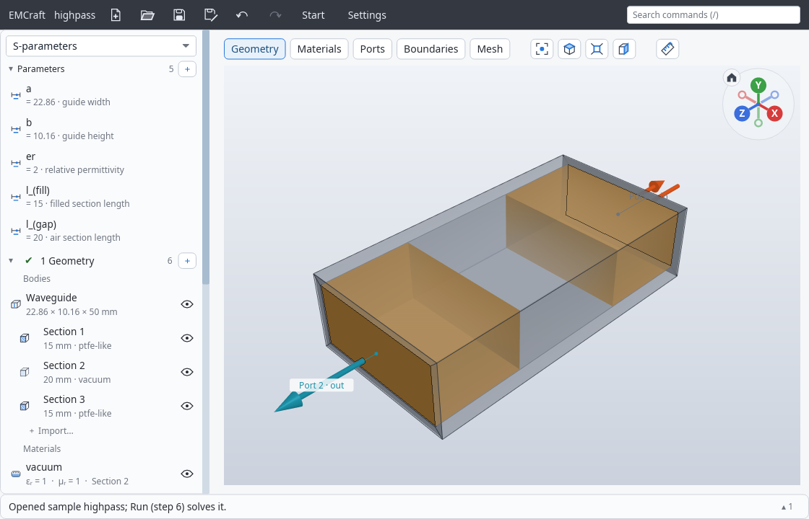
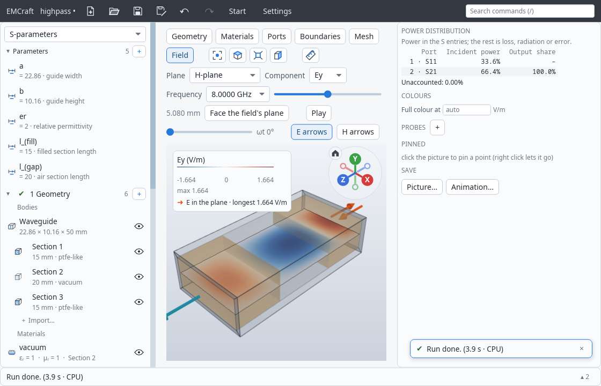
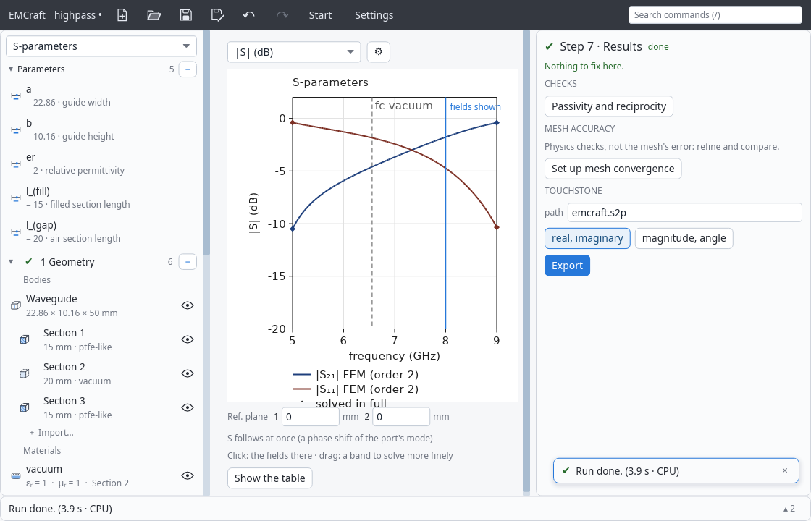

# Your first solve

**Goal:** solve a waveguide filter, read its S-parameters, look at the field inside it and
check that the answer can be trusted. It takes about five minutes; the solve itself takes
seconds.

The model is the `highpass` sample: a WR-90 waveguide filled with a dielectric (εr = 2) on both
sides of a 20 mm empty section. Below 6.56 GHz the empty section is cut off, so low frequencies
are reflected and high ones pass.



*What you will get: transmission |S21| rising and reflection |S11| falling across the band.*

## 1. Open the sample

```
emcraft --sample highpass
```

(From a clone of the repository: `cargo run --release -p emcraft -- --sample highpass`.)



The list at the left is the workflow, top to bottom: **Geometry**, **Excitation** (the ports),
**Setup** (the frequency band), **Region**, **Mesh**, **Run**, **Results**. Each step carries a
mark: a tick when it is done, a ring when it is still to do. The sample arrives with everything
ready up to Run.

In the 3D view the two filled sections are tinted, and the arrows are the two ports: the wave
goes in at Port 1 and out at Port 2. Drag to orbit, scroll to zoom.

## 2. Run

Press **▶** on the **Run** step.

The mesh is made, the band from 5 to 9 GHz is solved, and the window turns to the S-parameter
chart shown above. The message bar at the bottom says `Run done.` with the time it took.

On the chart:

- the blue curve is |S21|, what gets through; the red one is |S11|, what comes back;
- the dashed line `fc vacuum` is the empty section's cut-off, 6.56 GHz;
- the diamonds are the frequencies solved in full; the curve between them is the fast sweep.

The box above the chart switches to magnitude, phase, group delay or a Smith chart.

## 3. Look at the field

Click the chart at 8 GHz.



The view returns to the model with the field at that frequency drawn on a plane through the
guide. **Play** animates it through one period; **Plane** and **Component** choose what is
drawn. The panel at the right says where the power went: at 8 GHz 33.6 % is reflected and
66.4 % transmitted, with nothing unaccounted for, as it must be in a lossless filter.

## 4. Check the answer

Click **Results** in the workflow.



- **Passivity and reciprocity** tests the physics: the filter must not create power, and S12
  must equal S21.
- **Set up mesh convergence** solves again on a finer mesh and shows how far S moved. Do this
  on your own models before you rely on a number.
- **Export** writes the S-parameters as a Touchstone file (`.s2p`).

This sample has an exact solution, and EMCraft's result is checked against it: see
`highpass-filter` in the [verification table](../verification/results.md).

## 5. Change it

The filter's dimensions are the **Parameters** at the top of the list. Click `l_(gap)`, set its
value to `30` and press **Apply**: the model is rebuilt with a longer empty section, the Run
step is to do again, and its **▶** solves the new filter. A longer cut-off section lets less
through below 6.56 GHz.

## The same thing as a script

Everything you clicked is a command, so the whole session fits in a file:

```json
{{#include ../../scripts/first-solve.json}}
```

```
emcraft-cli run first-solve.json
```

It opens the sample and solves it, prints the physics checks (`"passive": true`, the
reciprocity and unitarity errors near 1e-14) and writes `highpass.s2p`. Every command and its
parameters are in the [command reference](../reference/commands.md).

To see the numbers against the exact solution, frequency by frequency:

```
emcraft-cli sample highpass --out pictures
```

## Next

- Pick the [sample](../reference/samples.md) closest to what you build and change its
  parameters.
- Read [how results are checked](../verification/how.md) before you rely on your own model.
