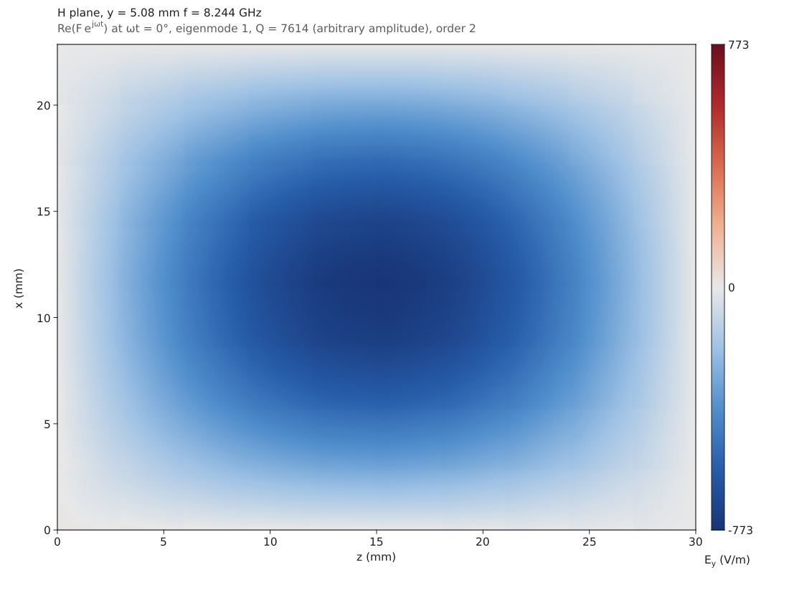
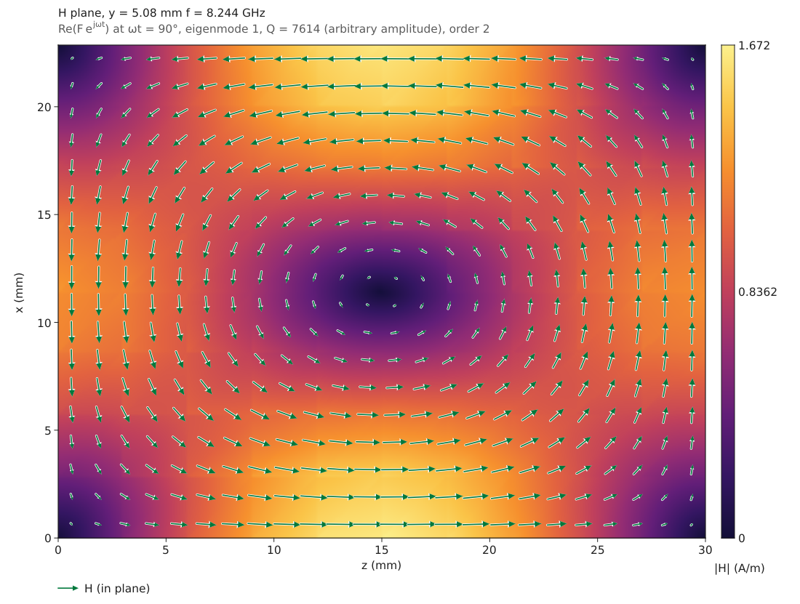
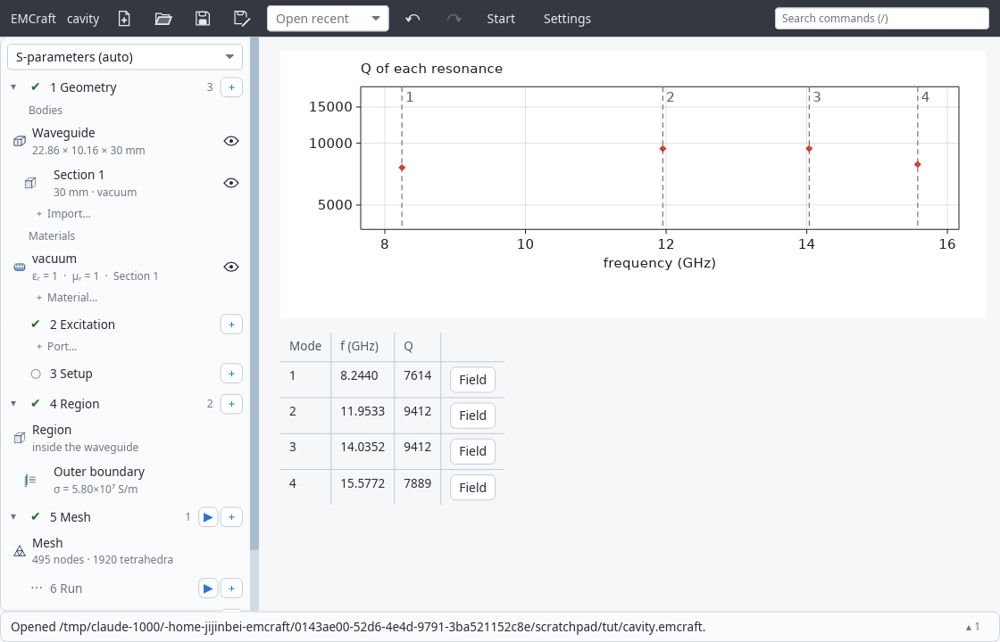

# Resonances and Q of a cavity

**Goal:** find the resonant frequencies of a metal cavity, the Q its copper walls give it, and
the shape of its lowest mode.



*What you will get: the TE101 mode at 8.244 GHz with Q = 7614, and its field.*

The cavity is a box 22.86 × 10.16 × 30 mm: a piece of WR-90 waveguide closed at both ends.
Nothing drives it, so there are no ports: an eigenmode analysis asks what the box does on its
own.

## The script

```json
{{#include ../../scripts/cavity.json}}
```

```
emcraft-cli run cavity.json
```

It runs in a few seconds.

## What each step does

1. **`geometry.waveguide`** with one section and no ports is a closed box.
2. **`model.walls`** gives the walls copper's conductivity, 5.8e7 S/m. Without it the walls are
   perfect conductors and Q is infinite.
3. **`mesh.generate`** fills the box with tetrahedra about 3 mm across.
4. **`solve.eigenmodes`** finds the four lowest resonances at element order 2.
5. **`results.eigenmodes`** prints them, and for a plain box the closed-form frequencies beside
   them:

   | Mode | EMCraft | Closed form | Q (copper) |
   |---|---|---|---|
   | TE101 | 8.2440 GHz | 8.2439 GHz | 7614 |
   | TE102 | 11.9533 GHz | 11.9523 GHz | 9412 |
   | TE201 | 14.0352 GHz | 14.0339 GHz | 9412 |
   | TE011 | 15.5772 GHz | 15.5767 GHz | 7889 |

6. **`view.field`** draws mode 1 twice: the electric field, and the magnetic field a quarter
   period later.



*`cavity-h.png`: the magnetic field circles the electric field's maximum.*

> **Phase matters for a mode's pictures.** In a resonance the electric and magnetic fields are a
> quarter period apart: when E is at its peak (ωt = 0), H is zero everywhere. Ask for H with
> `phase: 90`, or the picture is blank.

## Open it in the window

```
emcraft cavity.emcraft
```



The project opens on its modes: Q against frequency and the table. **Field** on a mode's row
shows that mode on the model, and **Play** animates it. The same model is the `cavity` sample on
the start page.

## Check your answer

- **Against the closed form.** A box's modes are f = (c/2)·√((m/a)² + (n/b)² + (p/d)²); the
  table above agrees to four digits.
- **Against a finer mesh.** Frequencies converge fast, Q more slowly: halve `size` and see that
  Q moves by less than you care about.

## Make it yours

A real resonator is rarely a plain box. The [samples](../reference/samples.md) under
*Resonators* add what changes the answer: a dielectric filling or puck (`slab-cavity`,
`dielectric-resonator`), a centre conductor (`coaxial-cavity`, `combline-resonator`), a nose
(`reentrant-cavity`). For a lossy dielectric the table also gives the dielectric's Q.
