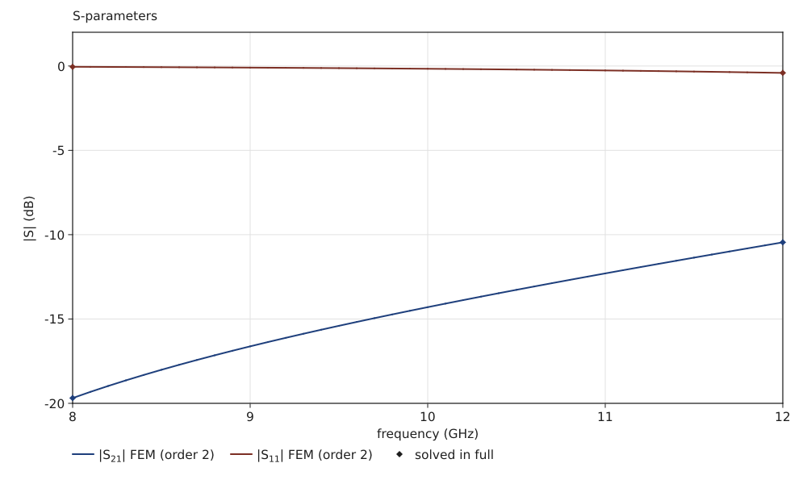
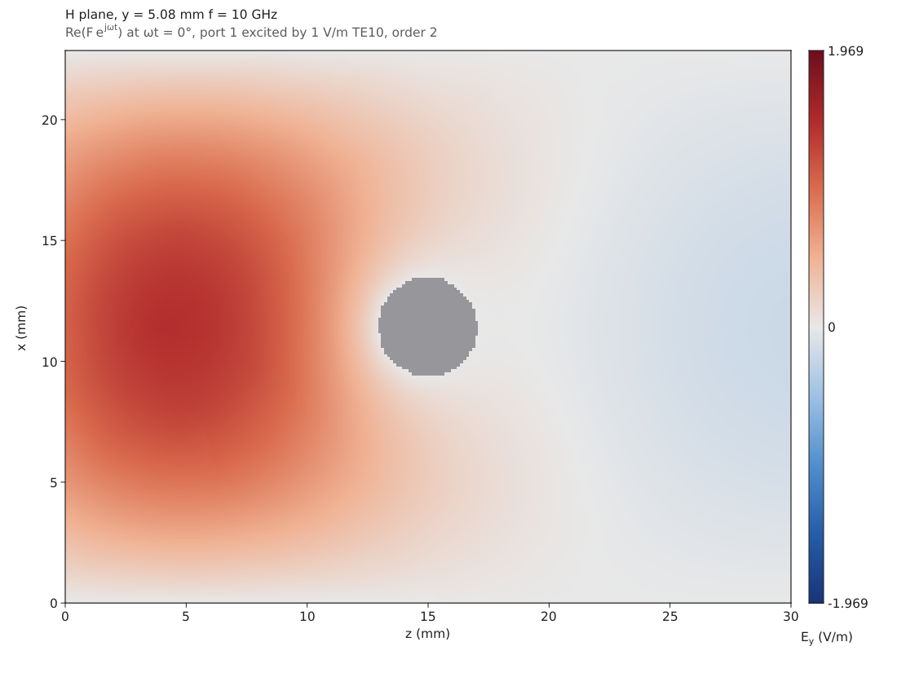

# Solve a part drawn in SolidCraft

**Goal:** take a waveguide part drawn in [SolidCraft](https://github.com/tangency-labs/solidcraft),
set one of its dimensions from EMCraft, and get its S-parameters with a mesh that refines
itself.



*What you will get: the reflection of a 4 mm metal post across a WR-90 guide, |S11| = 0.981 at
10 GHz, the same as the closed form.*

EMCraft reads a `.sc` design directly, not a triangulated export: cylinders stay
cylinders, so the mesh's curved elements follow the real surface, and the design's parameters
stay parameters.

The part here is [`post.sc`](https://github.com/jijinbei/emcraft/blob/main/tests/oracle/design-post/post.sc)
from the repository: one body, the air inside a 22.86 × 10.16 × 30 mm guide with a round hole
of diameter `d` through it where the post stands. Download it next to the script.

## The script

```json
{{#include ../../scripts/heavy/from-solidcraft.json}}
```

```
emcraft-cli run from-solidcraft.json
```

It takes about ten seconds.

## What each step does

1. **`geometry.import`** reads the design.
   - `parameters` sets the design's `d` to 4 mm (it was saved at 3): SolidCraft's own
     evaluator rebuilds the part, so the result is exact, not a scaled mesh.
   - `materials` says what each body is. `interior` marks the body that *is* the air to
     solve; every other body would be metal. If your design is drawn as its metal instead (a
     block with a channel through it), leave this out: EMCraft takes the air the metal
     encloses.
2. **`model.port.create`** puts the ports on the two ends of the air body.
3. **`mesh.adapt`** meshes, solves at 10 GHz, refines where the error is largest and solves
   again, until S changes by less than `tolerance` between passes. Here the second pass moves
   S by 7e-4, so it stops: the reply says `"converged": true`.
4. **`solve.frequency`** sweeps 8 to 12 GHz on that mesh; **`results.check`** tests the
   physics; the pictures and the project are written.



*`post-field.png`: the wave arrives from the left and most of it is reflected by the post.*

## In the window

Drop the `.sc` file on the window, or use **＋** on the Geometry step. The import
dialog shows what the file holds (its bodies, size and parameters) before anything is
imported. The design's row in the tree has a **↗** that opens it in SolidCraft; when you save
there, EMCraft reads it again.

<video controls muted playsinline preload="metadata" poster="../media/app-sparameters.png" style="max-width:100%">
  <source src="../media/walkthrough.mp4" type="video/mp4">
</video>

*The whole loop on a two-post resonator: drawn in SolidCraft, solved in EMCraft.*

## Check your answer

- **Converged.** `mesh.adapt` reports the change of S between its last two passes; that number
  is your mesh error estimate.
- **Against theory.** A full-height round post in a rectangular guide has a closed-form
  solution: |S11| = 0.98121 at 10 GHz for 4 mm. EMCraft gives 0.98124. This is the
  `design-post` case of the [verification table](../verification/results.md).

## Make it yours

- A part from another CAD system comes in as 3MF or STL with the same command; curved faces
  are then fitted (planes, cylinders, spheres, cones, tori) rather than exact.
- Write a design parameter as an expression of a project variable (`"parameters": {"d": "=d"}`
  after a `project.variable` named `d`), and a `study.sweep` over it rebuilds the part at each
  value.
