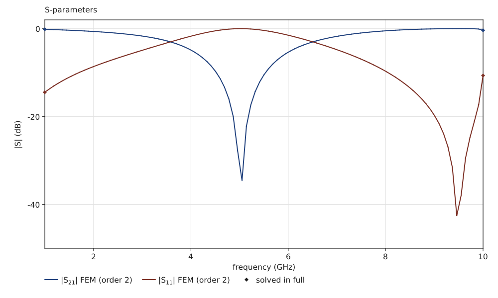

# A microstrip filter on a board

**Goal:** draw three traces on a two-layer board, solve them with the full-wave solver from 1
to 10 GHz, and find the filter's notch.



*What you will get: a notch of −35 dB at 5.05 GHz.*

The circuit is a 50 Ω line with an open stub 9 mm long hanging off its middle. Where the stub
is a quarter wavelength long its open end looks like a short at the junction, and nothing
passes.

## The script

```json
{{#include ../../scripts/heavy/microstrip-filter.json}}
```

```
emcraft-cli run microstrip-filter.json
```

It takes about forty seconds and 3 GB of memory.

## What each step does

1. **`pcb.load`** describes the board: the copper layers from the top down (`z` is the depth
   below the top layer, `eps_below` the dielectric under each layer) and the traces as
   segments with a net, a layer, two ends and a width. Here: 0.508 mm of εr = 3.55 under
   `F.Cu`, and three 1.1 mm segments, `in`, `out` and `stub`. A real board comes in with
   `pcb.import` from a KiCad file instead.
2. **`pcb.region`** chooses the part of the board to solve: a box from `lo` to `hi` with 5 mm
   of air above. `below: 0` puts the lowest layer on the box's conducting floor, which is the
   ground plane here.
3. **`pcb.port`** puts a 50 Ω lumped port at the free end of a trace, between the trace and
   its reference.
4. **`mesh.generate`** meshes copper, substrate and air together. `strip_edge` sets how much
   finer the mesh is at the traces' edges, where the current crowds.
5. **`solve.frequency`** sweeps the band; **`results.check`** tests passivity and reciprocity.
6. **`view.sparameters`**, **`results.touchstone`** and **`file.save`** write the chart,
   `stub.s2p` and the project.

## Open it in the window

```
emcraft stub.emcraft
```

The board shows in 3D with its ports, and the project opens on the S-parameter chart. The
samples under *Boards* on the start page (`pcb-stub-filter` is this one) have their dimensions
as parameters.

## Check your answer

- **A quarter wave.** On this substrate a 50 Ω line has ε_eff ≈ 2.8, so a quarter wavelength
  is 45 mm / f(GHz). The stub's 9 mm is measured from the centre of the main line; what acts
  as the stub is a little shorter, about 8.5 to 9 mm with the open end's fringing field, which
  puts the notch at 5.0 to 5.3 GHz. The full-wave answer is 5.05 GHz. If the two differed by a
  factor, the units or the stackup would be wrong.
- **Refine.** Halve `size` and see the notch stay put.

## Make it yours

- Lengthen the stub to lower the notch; add a second stub a quarter wave along the line to
  widen it.
- Before a full-wave solve, `pcb.inspect` screens a routed net in an instant: reference gaps,
  nearby parallel traces and, for a simple microstrip, its impedance and delay. See the
  `pcb-microstrip` and `pcb-split-ground` samples.
