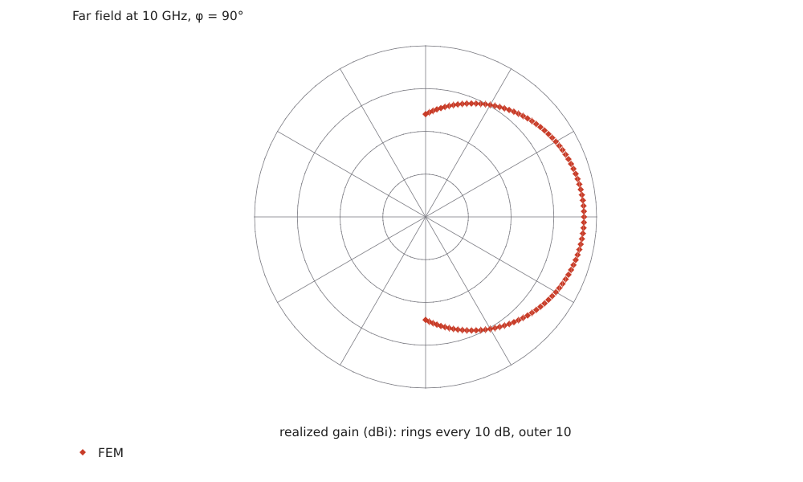

# Far field of a patch antenna

**Goal:** solve a microstrip patch antenna at 10 GHz and read its match, its gain and its
radiation pattern.



*What you will get: 7.1 dBi straight out of the patch, 22 dB less behind the board.*

The antenna is the `patch-antenna` sample: a 9.4 × 11.86 mm patch on 0.787 mm of εr = 2.2, fed
by a microstrip line through an inset that sets the match. An antenna radiates into open
space, so the model ends in a perfectly matched layer that absorbs what leaves.

## The script

```json
{{#include ../../scripts/heavy/patch-antenna.json}}
```

```
emcraft-cli run patch-antenna.json
```

It takes about twenty seconds and 5 GB of memory.

## What each step does

1. **`file.sample`** opens the sample with the three dimensions that matter most: the patch
   length `l` sets the resonant frequency, the width `w` the bandwidth and impedance level, the
   `inset` the match. The sample's script also builds the open boundary, the feed's lumped port
   and the mesh.
2. **`solve.radiation`** solves at one frequency. Its reply holds the match: here the input
   impedance is 63 − j9 Ω, so S11 = −17 dB, and the radiation efficiency is 1 (nothing in this
   model is lossy).
3. **`results.far_field`** gives the far field in the directions you ask for. Angles are those
   of the model's axes, and a board's normal is the model's **y** axis: straight out of the
   patch is θ = 90°, φ = 90°, and behind the board is φ = 270°.

   | Direction | Directivity | Realized gain |
   |---|---|---|
   | out of the patch (θ 90°, φ 90°) | 7.16 dBi | 7.07 dBi |
   | behind the board (θ 90°, φ 270°) | −15.24 dBi | −15.33 dBi |

   *Directivity* is the pattern's shape alone; *gain* takes off the antenna's losses;
   *realized gain* also takes off what the mismatch reflects, so it is what a link budget
   wants.
4. **`view.pattern`** draws a cut of the pattern: here θ from 0 to 180° at φ = 90°, through the
   patch's normal.
5. **`file.save`** keeps the project with its fields, so the window can show them.

## Open it in the window

```
emcraft patch.emcraft
```

The far-field page under Results draws the pattern: choose the cut, the quantity and the
polarization there.

## Check your answer

- **Power balance.** The radiated power the far field integrates to must equal the power the
  port delivers: the reply's `radiation_efficiency` is 1.000 here. A value off 1 in a lossless
  model means the mesh or the absorbing layer is too coarse.
- **Textbook size.** A patch resonates when it is about half a wavelength long in the
  substrate: at 10 GHz with εr = 2.2 that is about 10 mm, less the fringing fields, so 9.4 mm.
  Its gain is typically 6 to 8 dBi.
- The radiation solver itself is [checked](../verification/results.md) on dipoles, a horn and
  an open waveguide against their closed forms.

## Make it yours

For another frequency, scale `l` with the wavelength, then sweep `inset` for the best S11: the
sample's dimensions are parameters, so a `study.sweep` does it in one command. For the match
over a band rather than at one frequency, use `solve.radiation_sweep`.
