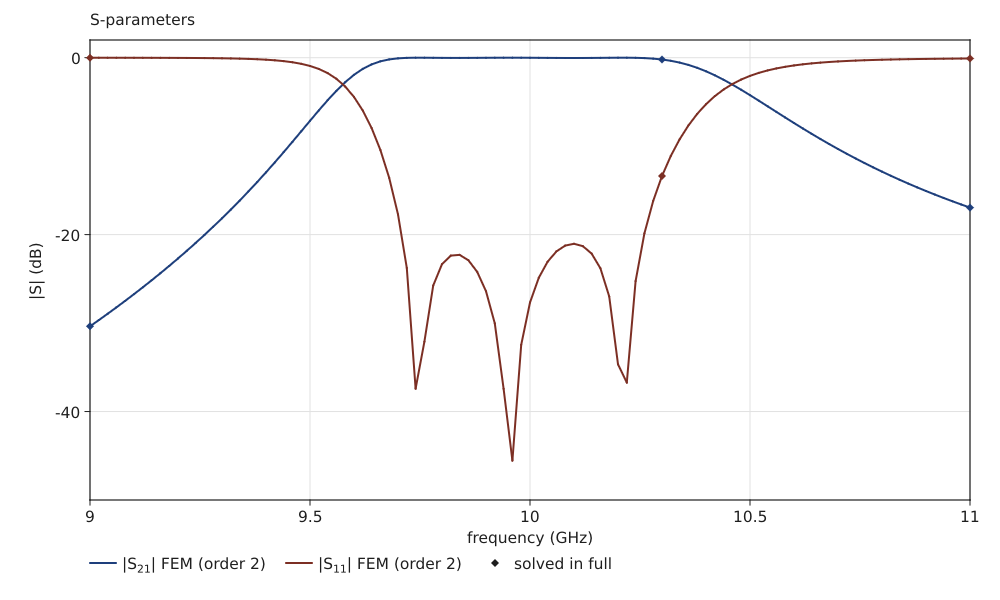
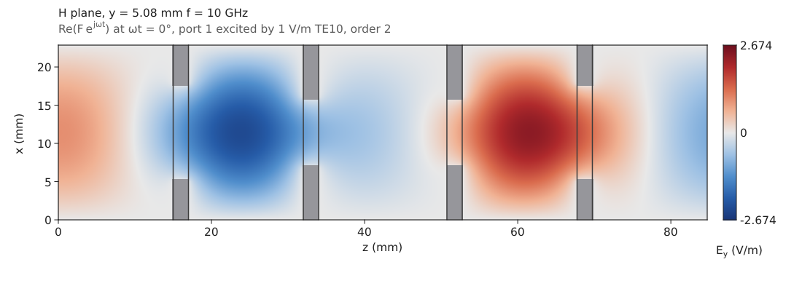

# S-parameters of a waveguide filter

**Goal:** build a band-pass filter from nothing, sweep it from 9 to 11 GHz, and check the
result. You will write the model as a script; every command in it is also in the window, on the
**＋** of the step it belongs to.



*What you will get: a passband from about 9.75 to 10.25 GHz with the reflection below −20 dB.*

The filter is three cavities in a WR-90 waveguide (22.86 × 10.16 mm), separated by four
inductive irises: thin walls across the guide with a window in the middle.

## The script

```json
{{#include ../../scripts/heavy/waveguide-filter.json}}
```

Save it as `waveguide-filter.json` and run it:

```
emcraft-cli run waveguide-filter.json
```

It takes about ten seconds and a gigabyte of memory. Lengths are in millimetres and frequencies
in gigahertz.

## What each step does

1. **`geometry.iris_filter`** makes the guide and its irises. The two outer irises have a
   12.75 mm window and the two inner ones 9.25 mm; the cavities are 15, 16.75 and 15 mm long. A
   narrower window couples two cavities less, which narrows the passband.
2. **`model.port.create`**, twice, puts a port on each end of the guide. `modes: 4` lets each
   port absorb four waveguide modes, so the evanescent fields of the nearest iris do not
   reflect off the port.
3. **`mesh.generate`** fills the guide with tetrahedra about 3 mm across. `edge: 0.1` makes them
   ten times smaller at the iris edges, where the field is singular; `size_y` equal to the guide
   height uses one layer across it, exact here because nothing varies along y in this filter.
4. **`solve.frequency`** sweeps the band. `order: 2` is the element order (use 2 unless memory
   forces 1). Of the 101 points only a few are solved in full; the fast sweep fills in the rest
   and adds full solves where it is unsure.
5. **`results.check`** tests the physics. A lossless filter must be passive, reciprocal and
   unitary; the reply gives the three errors, here all below 1e-13.
6. **`view.sparameters`** and **`view.field`** write the pictures; **`results.touchstone`**
   writes `bandpass.s2p` for a circuit simulator.
7. **`file.save`** keeps the project. `fields: false` leaves the field vectors out, which makes
   the file 1 MB instead of 350 MB; the S-parameters are kept either way.



*`bandpass-field.png`: at 10 GHz, in the passband, all three cavities resonate.*

## Open it in the window

```
emcraft bandpass.emcraft
```

The project opens on its S-parameter chart without solving again. To look at fields in the
window, press **▶** on Run once (this project was saved without them), then click the chart at
a frequency. To change the filter, edit a section in the Geometry step and run again.

## Check your answer

- **The physics checks pass**, as above.
- **The mesh is fine enough.** Halve `size` to 1.5 and run again: the passband edges should move
  by far less than the bandwidth. In the window, **Set up mesh convergence** in the Results
  step does this for you.
- This filter is also the `iris-bandpass` [sample](../reference/samples.md), and the case of
  that name in the [verification table](../verification/results.md) checks it.

## Make it yours

For another band, scale the guide (`width`, `height`) to its standard size and the cavity
lengths to about half a guide wavelength at the centre frequency; then tune the windows. The
`iris-bandpass` sample has every dimension as a parameter, ready for a sweep or an
optimization.
